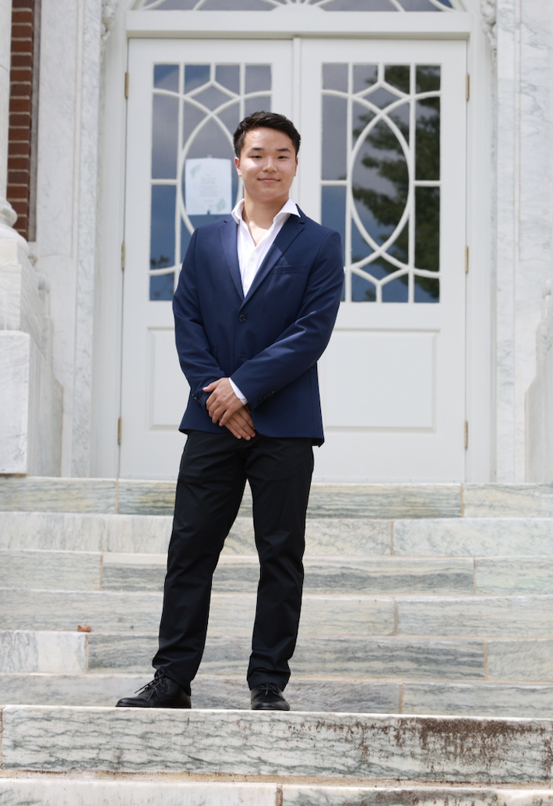
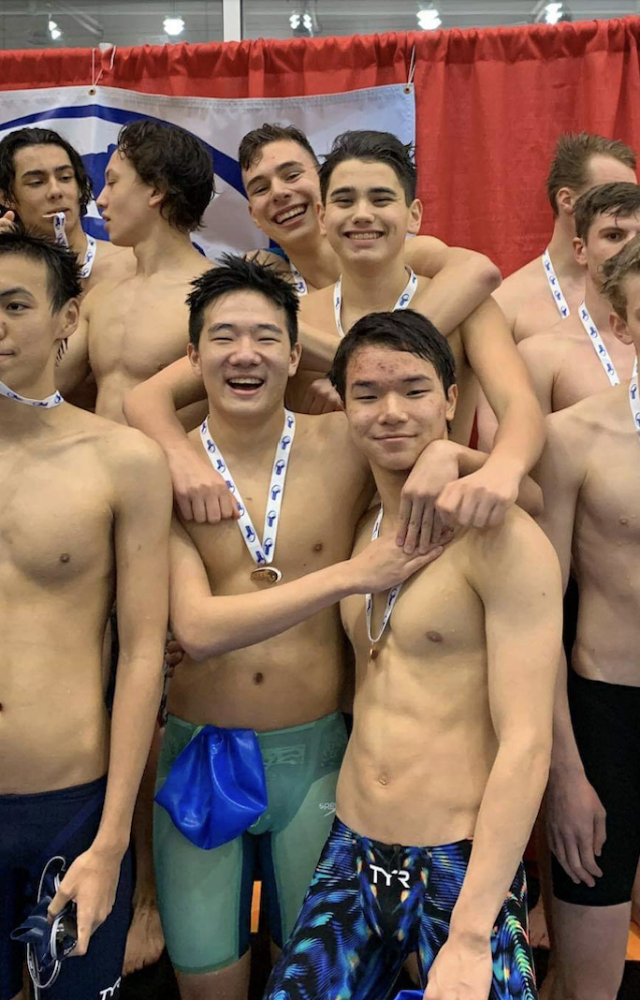
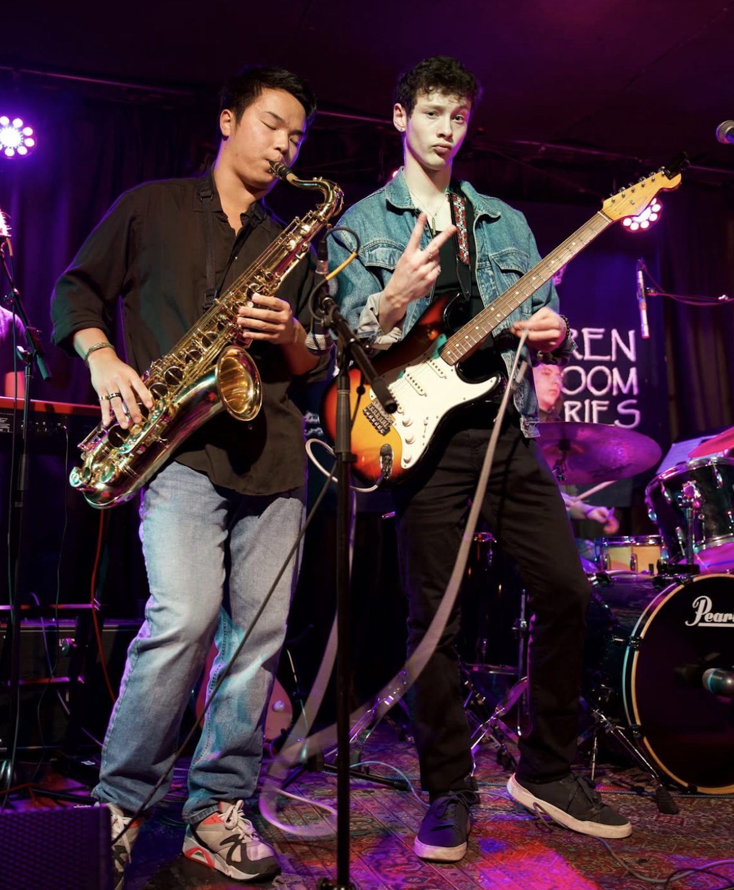
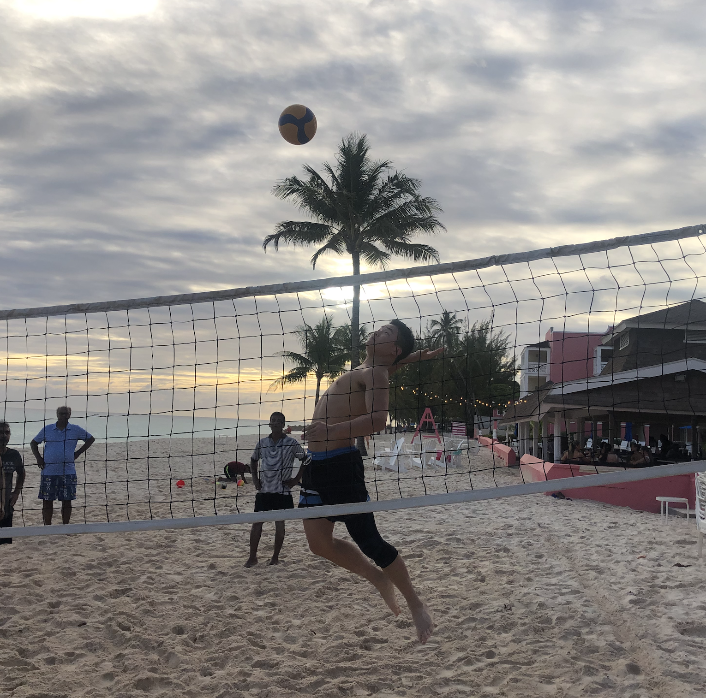

an aspiring data scientist currently attending Columbia University at Mailman School of Public Health. I enjoy the exploration of the unknown, and I am enthusiastic about tackling problems and creating innovative solutions.

## About me

I've always been fascinated by how the world works — whether through the lens of Biostatistics, Physics, or human experience. My passion lies in taking an interdisciplinaryapproach that integrates physics-based modeling and data analytics with biological systems and healthcare.

I am currently attending Columbia University in their Biostatistics MS program, looking to build out my quantitative skills and create connections with those in healthcare. I graduated from Tufts in the Spring of 2025 with  Summa Cum Laude honors and a High Honors Senior Thesis.

## Me in 50 words

I'm an adventurous soul who looks to create memories with those around me because I believe that not trying is worse than failing. I've read books on the structure of the universe, led discussions with inquisitive minds, and traveled todifferent countries to further broaden my perspective of the world.

To learn more about my academic journey, click [here](about.html)

## Hobbies and interests

Outside of academics, I have several hobbies that I have given me meaningful experiences, helping me connect to others and share perspectives. I loved athletics as a kid and to this day, as I feel its just as important to maintain good health as it is to grow our knowledge to fulfill our dreams and aspirations.From the ages of seven to seventeen, I swam on a local YMCA and Club team (Charles River Aquatics), competing in both local and USA meets. While it was time consuming, painful, and stressful at times, I wouldn't be the person who I am today as overcoming the many difficulties that came with swimming made me stronger and more disciplined as a person. This culminated in high school where I was given the opportunity to be captain of my swim team and lead us to our best placement in the state championship meet that we had in our school's history - or at least as far back as anyone could remember. After high school, I felt as though I had given swimming all I could, so I switched to the polar opposite sport, volleyball. Filled with teamwork, communication, much less cardio, and more pain on the knees, I began to love this new sport. For my freshman year of university, I played nearly everyday, making life long friends in the process. In line with my interest, I quickly was able to join the club volleyball team where I have been a part of for the last four years. Playing volleyball has given me some of the greatest and most exhilarating moments in my life, but it hasn't come without its costs. I've dealt with recurring knee issues and I've had to learn how to properly take care of myself, which sometimes includes time away from the sport I love. Sports have taught me plenty of life lessons and I hope to continue learning more for the rest of my life.

Another interest of mine is music. I grew playing the piano, but I soon found that practicing and memorizing countless classic piano songs wasn't for me, so I soon quit. In fourth grade, I would then learn how to play the alto saxophone, an instrument that represented style and creativity. I would soon lean towards playing jazz as it aligned with my style of playing music and improv became my expression for that. I continued playing into high school where our school's jazz ensemble qualified for the Mingus Big Band competition and traveled to New York to compete. In college, every spring I've played with some Jazz group, with the same interest in meeting new people with a similar passion for music and developing my own skills. Throughout the years, I've also learned the basics for guitar, ukulele, trumpet, flute, drums, and even some singing. 

Some other hobbies of mine include: cooking, swimming, and learning new skills. My mom's cooking will always remain undefeated, but I think I emulate her cooking somewhat successfully. As a combination of making that I personally like to eat and saving money, cooking has become a central part of my life. Similarly, swimming was such a big part of my life that every now and then, I love to hop back into the pool. Lastly, I think learning new skills, as a general statement, is an amazing thing. Whether its learning how to juggle a soccer ball or learning where to invest in the stock market, I believe learning new skills has broadened my perspective on several different facets of life.

